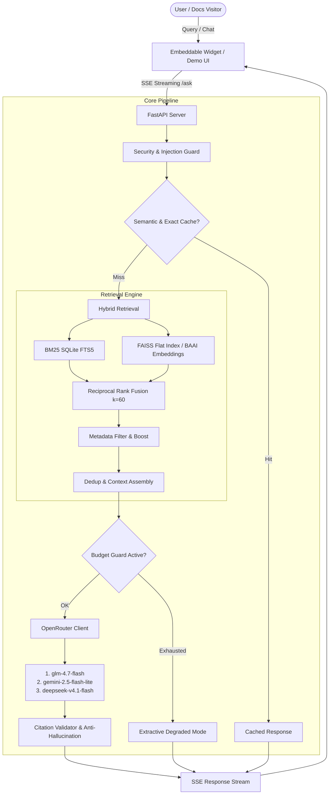

# Ask OLake 🌊

> **Production-grade RAG chat assistant for OLake documentation and GitHub repositories.**

Ask OLake is an intelligent, citation-backed documentation assistant built specifically for [OLake](https://olake.io) — covering OLake Ingestion (replications from Postgres, MySQL, MongoDB, Oracle, MSSQL, DB2, Kafka, and S3 into Apache Iceberg or Parquet) and OLake Fusion (automated Iceberg table maintenance).

---

## Key Features

- **Hybrid Retrieval**: BM25 (SQLite FTS5) + Dense Vector Embeddings (BAAI/bge-small-en-v1.5 running locally on ONNX Runtime) + Reciprocal Rank Fusion (RRF, $k=60$) + metadata boost.
- **Strict Citation Validation**: Every claim is cited with numbered markers (`[1]`, `[2]`) mapped to official docs. Hallucinated URLs are automatically detected and stripped before delivery.
- **Resilient Multi-Model LLM Layer (OpenRouter)**:
  - Primary: `z-ai/glm-4.7-flash`
  - Fallbacks: `google/gemini-2.5-flash-lite`, `deepseek/deepseek-v4.1-flash`
  - Zero-effort reasoning optimization (`reasoning: {"effort": "none"}`) with auto-fallback.
- **Budget Guard & Extractive Degraded Mode**: If LLM budget is exhausted or upstream models return 402/403, the system gracefully falls back to extractive answers directly from verbatim docs chunks (zero LLM calls).
- **Two-Tier Caching**: Exact SHA256 query cache + semantic vector similarity cache ($\cos > 0.95$), persisted across container restarts in SQLite.
- **Freshness SLA (< 1 hour)**: 30-minute background crawler with ETag and `If-Modified-Since` conditional GETs.
- **Embeddable Chat Widget**: Zero-dependency vanilla Web Component (`<ask-olake-chat>`) with Shadow DOM CSS isolation, streaming responses, code copy, and light/dark theme.
- **Single-Command Docker Deployment**: Ready-to-ship `docker-compose.yml` with optional Traefik HTTPS and pre-seeded vector index.

---

## Architecture Overview



---

## Quick Start (Local Development)

### 1. Clone & Configure Environment

```bash
git clone https://github.com/datazip-inc/olake.git
cd olake
cp .env.example .env
```

Edit `.env` and add your OpenRouter API key:
```env
OPENROUTER_API_KEY=sk-or-v1-...
ADMIN_TOKEN=your-super-secret-admin-token
```

### 2. Verify API Keys

```bash
make check-keys
```

### 3. Run Ingestion

```bash
# Ingest official docs into local SQLite & FAISS index
make ingest-docs
```

### 4. Run the Dev Server

```bash
make dev
```

Visit the interactive demo at: **http://localhost:8000/demo**

---

## Production Deployment

### Option A: Fresh Ubuntu VPS to Public HTTPS (Primary)

Deploying to an Ubuntu VPS (DigitalOcean, Hetzner, AWS EC2, GCP Compute Engine):

1. **Install Docker and Docker Compose**:
   ```bash
   curl -fsSL https://get.docker.com | sh
   sudo usermod -aG docker $USER
   # Log out and back in, or run newgrp docker
   ```

2. **Clone and Configure**:
   ```bash
   git clone https://github.com/datazip-inc/olake.git
   cd olake
   cp .env.example .env
   nano .env
   ```
   Set `OPENROUTER_API_KEY`, `ADMIN_TOKEN`, and your domain:
   ```env
   DOMAIN=ask.yourdomain.com
   ACME_EMAIL=admin@yourdomain.com
   PORT=80
   ```

3. **Launch with Docker Compose**:
   ```bash
   # Build and start services in the background
   make up
   ```
   The first boot loads the seeded index. The healthcheck (`/healthz`) verifies the container is alive within seconds.

4. **Monitor Logs**:
   ```bash
   make logs
   ```

---

### Option B: Deploy from Laptop via Cloudflare Tunnel (`cloudflared`)

If deploying from a local development machine during hackathon judging:

> [!WARNING]
> Your laptop must remain powered on, awake, and connected to the internet during the entire evaluation period. Disable sleep in OS settings (`caffeinate` on macOS or system settings on Linux).

1. **Start the local Docker Compose stack**:
   ```bash
   make up
   ```

2. **Install and run Cloudflare Tunnel**:
   ```bash
   # On Ubuntu/Debian:
   curl -L --output cloudflared.deb https://github.com/cloudflare/cloudflared/releases/latest/download/cloudflared-linux-amd64.deb
   sudo dpkg -i cloudflared.deb

   # Launch a quick tunnel to local port 8000 (no domain needed):
   cloudflared tunnel --url http://localhost:8000
   ```

3. **Share Public URL**:
   Cloudflare outputs a public HTTPS URL (e.g., `https://random-words.trycloudflare.com`).
   - Widget Demo: `https://random-words.trycloudflare.com/demo`
   - API Ask endpoint: `https://random-words.trycloudflare.com/ask`

---

## API Endpoints Reference

| Method | Endpoint | Description | Auth Required |
|:---|:---|:---|:---|
| `POST` | `/ask` | Streaming RAG question answering (SSE / JSON) | None |
| `GET` | `/healthz` | Container liveness check | None |
| `GET` | `/readyz` | Readiness check (validates index loaded) | None |
| `GET` | `/freshness` | Index freshness metadata and SLA status | None |
| `POST` | `/feedback` | User thumbs up/down feedback logging | None |
| `GET` | `/demo` | Interactive testbed and embed playground | None |
| `GET` | `/static/*` | Prebuilt widget bundle (`ask-olake.iife.js`) | None |
| `GET` | `/admin/stats` | Cache hit rate, latency, request counters | Bearer Token |
| `POST` | `/admin/reindex` | Trigger background re-crawl and reindex | Bearer Token |

---

## Embedding the Widget

Add this snippet before `</body>` on any docs site (Docusaurus, MkDocs, Next.js, Hugo):

```html
<!-- Ask OLake Widget -->
<script
  src="https://your-api-domain.com/static/ask-olake.iife.js"
  data-api="https://your-api-domain.com"
  data-theme="auto"
  data-position="bottom-right"
></script>
```

Or embed inline directly inside a page:

```html
<ask-olake-chat
  data-api="https://your-api-domain.com"
  data-theme="dark"
></ask-olake-chat>
```

---

## Makefile Cheatsheet

```bash
make up             # Build and launch Docker Compose stack
make down           # Stop Docker containers
make logs           # Stream container logs
make test           # Run comprehensive unit and integration test suite
make check-keys     # Validate OpenRouter and Cohere API credentials
make ingest-docs    # Crawl and index OLake documentation
make ingest         # Crawl docs and GitHub repositories
make eval           # Run RAG evaluation against running API
make reindex        # Trigger remote reindex via /admin/reindex
make stats          # View remote /admin/stats
```

---

## Evaluation Suite

To evaluate answer accuracy, source attribution, and retrieval recall:

```bash
# Run against local dev server:
make eval

# Results are saved in markdown format to:
cat eval/results.md
```
